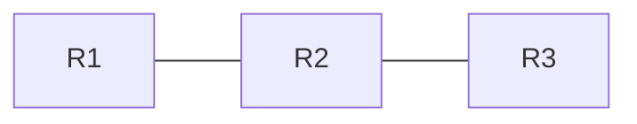

# 📋 题目格式规范

> **目的**：让所有题目都有统一的结构，便于检索、统计、刷题、复用。

---

## 1. 文件位置

| 类型 | 路径 | 命名 |
|------|------|------|
| HCIE-RS 笔试 | `exams/HCIE-RS/written/` | `YYYY-MM-<topic>-<n>.md` |
| HCIE-RS 实验 | `exams/HCIE-RS/lab/` | `YYYY-MM-<topic>-<n>.md` |
| HCIE-RS 面试 | `exams/HCIE-RS/interview/` | `YYYY-MM-<topic>-<n>.md` |
| CCIE-RS 笔试 | `exams/CCIE-RS/written/` | `YYYY-MM-<topic>-<n>.md` |
| CCIE-RS 实验 | `exams/CCIE-RS/lab/` | `YYYY-MM-<topic>-<n>.md` |
| CCIE-RS 面试 | `exams/CCIE-RS/interview/` | `YYYY-MM-<topic>-<n>.md` |
| 模拟卷 | `exams/mocks/` | `<vendor>-<date>-mock-<n>.md` |
| 知识点 | `knowledge/XX-<topic>/` | `<topic>.md` |

> 编号 `n` 用三位数：`001` / `002` / ...，按入库顺序递增。

---

## 2. 文件结构（强制）

每个题目文件**必须**由三部分组成：

1. **YAML Front Matter**（元数据，**必须**）
2. **Markdown 正文**（题目 + 选项 + 答案 + 解析）
3. **Footer**（溯源、变更记录）

### 2.1 YAML Front Matter

```yaml
---
id: HCIE-RS-W-2024-001          # 唯一 ID（格式见下）
type: single-choice             # 题型（见下）
vendor: Huawei                  # 厂商：Huawei / Cisco
cert: HCIE-RS                   # 认证全称
stage: written                  # 阶段：written / lab / interview
date: 2024-06                   # 出题/考试年月
source: 华为官方模拟题库 V3.0     # 来源（必填，强制可追溯）
source_url:                     # 可选：来源 URL（可点击验证）
difficulty: 3/5                 # 难度 1-5
tags: [ospf, lsa, area]         # 标签（见 TAG-SYSTEM.md）
status: verified                # 状态：draft / verified / disputed
verified_by: @你的GitHub用户名     # verified 状态时必填
verified_date: 2024-07-15       # verified 状态时必填
created: 2024-07-10             # 入库日期
updated: 2024-07-15             # 最后更新
---
```

### 2.2 ID 命名规范

```
<VENDOR>-<CERT>-<STAGE>-<YEAR>-<NUMBER>
```

| 字段 | 缩写 | 取值 |
|------|------|------|
| VENDOR | HCIE / CCIE | - |
| CERT | RS / SEC / DC / SP 等 | - |
| STAGE | W / L / I | Written / Lab / Interview |
| YEAR | 四位年 | - |
| NUMBER | 三位序号 | 001 ~ 999 |

示例：
- `HCIE-RS-W-2024-001` —— HCIE 路由交换 笔试 2024 年 第 1 题
- `CCIE-SP-L-2023-005` —— CCIE Service Provider 实验 2023 年 第 5 题

### 2.3 题型 type

| type | 说明 |
|------|------|
| `single-choice` | 单选 |
| `multi-choice` | 多选 |
| `true-false` | 判断 |
| `fill-blank` | 填空 |
| `short-answer` | 简答 |
| `lab` | 实验配置题 |
| `troubleshoot` | 排障题 |
| `case` | 案例分析 |
| `interview-q` | 面试问答 |

---

## 3. 正文模板

### 3.1 选择题 / 判断题 / 填空题

```markdown
# <题目标题（一句话概括）>

<题目正文>

A. 选项 1
B. 选项 2
C. 选项 3
D. 选项 4

## 答案

**B** （多选用 `**B, C**`）

## 解析

<详细解析，引用 RFC / 官方文档 / 实验验证>

> 参考：[RFC 2328 §A.3](https://www.rfc-editor.org/rfc/rfc2328) 
> / [Huawei NE40E 手册](...)

## 厂商差异

> 如果 Cisco 和 Huawei 实现不同，必须写这个 section。

| 维度 | Huawei | Cisco |
|------|--------|-------|
| 概念名 | 区域 | Area |
| 配置命令 | `ospf area 0` | `area 0` |
| 默认行为 | ... | ... |
```

### 3.2 实验题

```markdown
# 实验题目

## 拓扑



## 需求

1. R1-R2-R3 运行 OSPF Area 0
2. R1 与 R3 建立 IBGP
3. ...

## 参考配置

### Huawei（NE40E）

```bash
# R1
ospf 1 router-id 1.1.1.1
 area 0.0.0.0
  network 10.1.1.0 0.0.0.255
```

### Cisco（XR / IOS-XE）

```bash
# R1
router ospf 1
 router-id 1.1.1.1
 network 10.1.1.0 0.0.0.255 area 0
```

## 验证

```bash
# Huawei
display ospf peer brief

# Cisco
show ip ospf neighbor
```

## 易错点

- ⚠️ Huawei 区域 ID 支持点分十进制，Cisco 只支持整数
- ⚠️ ...
```

### 3.3 面试题

```markdown
# <面试题>

## 题目

请描述 OSPF 邻居建立过程，并解释每种状态机的含义。

## 参考答案（要点）

1. Down → Init：互相收到 Hello
2. Init → 2-Way：双向通信建立
3. 2-Way → Exstart：协商 Master/Slave
4. ...

## 追问点（面试官可能继续问）

- Q: DR/BDR 选举在哪个状态完成？
- Q: 如果是 MA 网络，2-Way 后直接进入 Exchange 吗？

## 个人回答记录

> 2024-07-20 模拟面试

- 时长：3 分钟
- 漏点：没提到 DD 序列号
- 改进：补充 LSDB 同步过程图
```

---

## 4. Footer

文件末尾**必须**有：

```markdown
---

## 📚 参考资料

- [RFC 2328 - OSPF Version 2](https://www.rfc-editor.org/rfc/rfc2328)
- Huawei S9300 配置指南 - OSPF 章节
- 自己的实验笔记：[lab/huawei/ospf-basic.md](../../lab/huawei/ospf-basic.md)

## 📝 变更记录

| 日期 | 改动 | 作者 |
|------|------|------|
| 2024-07-10 | 初稿 | @yourname |
| 2024-07-15 | 补充厂商差异表 | @yourname |
```

---

## 5. 质量检查清单

PR 提交前**自查**：

- [ ] 元数据完整（id / type / vendor / source / tags 都有）
- [ ] source 字段填了具体来源，**不是**"网络" / "朋友分享"
- [ ] 解析有 RFC / 官方文档 / 实验依据，**不是**"我觉得"
- [ ] 双厂商对照题有"厂商差异"表格
- [ ] 代码块标注了厂商（Huawei / Cisco / 通用）
- [ ] Footer 有参考资料和变更记录
- [ ] 没有截图（用文字 + mermaid 代替，方便 diff）

---

## 6. 反例

❌ **不合格**：

```markdown
# OSPF 题目

下列哪个是 ABR？（答案 A）

解析：ABR 是区域边界路由器。
```

问题：
- 没有元数据
- source 缺失
- 解析太简略，无依据
- 没有厂商差异

✅ **合格**：

见上文 3.1 完整模板。

---

*本规范自 v1.0 起执行。如有修改建议，开 Issue 讨论。*
