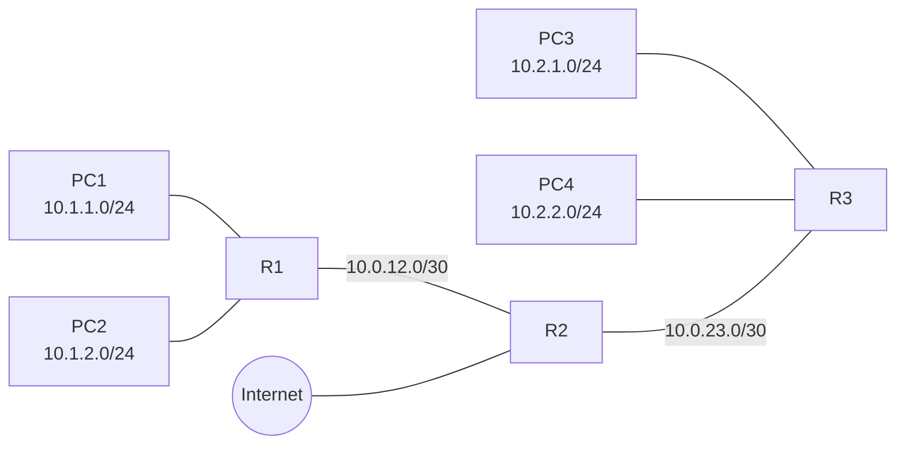

# OSPF 多区域 + 区域间路由汇总

## 拓扑



## 设备角色

| 设备 | 角色 | 区域 | Loopback |
|------|------|------|----------|
| R1 | ABR | Area 0 + Area 1 | 1.1.1.1/32 |
| R2 | ASBR + ABR | Area 0 + Area 2 + BGP to Internet | 2.2.2.2/32 |
| R3 | ABR | Area 0 + Area 3 | 3.3.3.3/32 |

## 需求

1. R1 和 R3 之间通过 R2 互联（**不能直连**）
2. **R3 连接的 Area 3 配置为 Stub 区域**（不允许外部路由，减少 LSDB）
3. R1 上对 Area 1 的路由（10.1.0.0/16）做**区域间路由汇总**，在 ABR 上配置
4. R3 上对 Area 3 的路由（10.2.0.0/16）做**区域间路由汇总**
5. R2 通过 EBGP 连接到 Internet，引入 100.100.100.0/24（模拟 Internet 路由）
6. **验证需求**：
   - R1 路由表里看到 `O IA 10.2.0.0/16`（汇总后的）
   - R3 路由表里看到 `O IA 10.1.0.0/16`（汇总后的）+ 默认路由（来自 ABR，**Type-3 LSA**）
   - R3 路由表里**没有 E1/E2** 外部路由（因为是 Stub 区域）

## 参考配置

### R1 配置

```bash
sysname R1

# 物理接口
interface GigabitEthernet0/0/0
 ip address 10.0.12.1 255.255.255.252
interface GigabitEthernet0/0/1
 ip address 10.1.1.254 255.255.255.0
interface GigabitEthernet0/0/2
 ip address 10.1.2.254 255.255.255.0
interface LoopBack0
 ip address 1.1.1.1 255.255.255.255

# OSPF
ospf 1 router-id 1.1.1.1
 area 0.0.0.0
  network 10.0.12.0 0.0.0.3
  network 1.1.1.1 0.0.0.0
 area 0.0.0.1
  network 10.1.1.0 0.0.0.255
  network 10.1.2.0 0.0.0.255
 # 区域间路由汇总
  abr-summary 10.1.0.0 255.255.0.0
```

### R2 配置

```bash
sysname R2

interface GigabitEthernet0/0/0
 ip address 10.0.12.2 255.255.255.252
interface GigabitEthernet0/0/1
 ip address 10.0.23.2 255.255.255.252
interface GigabitEthernet0/0/2
 ip address 200.1.1.1 255.255.255.252    # 连接 Internet
interface LoopBack0
 ip address 2.2.2.2 255.255.255.255

# OSPF（Area 0 + Area 2）
ospf 1 router-id 2.2.2.2
 area 0.0.0.0
  network 10.0.12.0 0.0.0.3
  network 10.0.23.0 0.0.0.3
  network 2.2.2.2 0.0.0.0
 area 0.0.0.2
  network 100.100.100.0 0.0.0.255          # 模拟 Internet 路由（在 Area 2）
  network 200.1.1.0 0.0.0.3

# BGP（连接 Internet）
bgp 65001
 router-id 2.2.2.2
 peer 200.1.1.2 as-number 65002
 #
 ipv4-family unicast
  network 100.100.100.0 255.255.255.0      # 把 100.100.100.0/24 注入 BGP
  import-route ospf 1                       # 把 OSPF 路由引入 BGP
  peer 200.1.1.2 enable
```

### R3 配置

```bash
sysname R3

interface GigabitEthernet0/0/0
 ip address 10.0.23.3 255.255.255.252
interface GigabitEthernet0/0/1
 ip address 10.2.1.254 255.255.255.0
interface GigabitEthernet0/0/2
 ip address 10.2.2.254 255.255.255.0
interface LoopBack0
 ip address 3.3.3.3 255.255.255.255

# OSPF（Area 0 + Area 3，Area 3 是 Stub）
ospf 1 router-id 3.3.3.3
 area 0.0.0.0
  network 10.0.23.0 0.0.0.3
  network 3.3.3.3 0.0.0.0
 area 0.0.0.3
  network 10.2.1.0 0.0.0.255
  network 10.2.2.0 0.0.0.255
  stub                                      # 标记为 Stub 区域
 # 区域间路由汇总
  abr-summary 10.2.0.0 255.255.0.0
```

> ⚠️ **重要**：Area 3 配置为 Stub 区域，**R2 也要在 Area 3 接口上配 `stub`**（区域所有设备必须一致）！

### R2 的 Area 3 接口配置（**补充**）

R2 和 R3 的 Area 3 接口都需要配 `stub`：

```bash
# R2 - 在连接 R3 的接口上也标记 stub
interface GigabitEthernet0/0/1
 # ... 已配 IP
# 在 OSPF 进程下：
ospf 1
 area 0.0.0.0
  # ... 已有 network
 area 0.0.0.3
  network 10.0.23.0 0.0.0.3
  stub
```

## 验证命令

### R1 验证

```bash
display ospf peer brief
# 期望：看到 R2，State = Full

display ospf routing
# 期望看到：
#   10.0.12.0/30  Direct
#   10.0.23.0/30  OSPF
#   1.1.1.1/32    Direct
#   2.2.2.2/32    OSPF
#   3.3.3.3/32    OSPF
#   10.1.1.0/24   Direct
#   10.1.2.0/24   Direct
#   10.2.0.0/16   O IA      ← 汇总后的（不是 10.2.1.0/24 + 10.2.2.0/24）
#   100.100.100.0/24  O_ASE  ← 来自 R2 引入的 BGP

display ip routing-table
# 同上
```

### R3 验证

```bash
display ospf peer brief
# 期望：看到 R2，State = Full

display ospf lsdb
# 期望：LSDB 里**没有** Type-5 LSA（因为是 Stub 区域）
# Type-3 LSA 数量较少（只有区域间 + 1 个默认路由）

display ip routing-table
# 期望看到：
#   10.0.23.0/30     Direct
#   3.3.3.3/32       Direct
#   10.2.1.0/24      Direct
#   10.2.2.0/24      Direct
#   2.2.2.2/32       OSPF
#   10.0.12.0/30     OSPF
#   1.1.1.1/32       OSPF
#   10.1.0.0/16      O IA    ← 来自 R1 的汇总
#   0.0.0.0/0        O IA    ← 默认路由（ABR 自动生成）
#   **没有** 100.100.100.0/24（Stub 区域不学外部路由）
```

## 易错点

### ⚠️ Stub 区域必须双向配

- R3 配 `stub` 后，R2 的 Area 3 接口也必须配 `stub`
- 不一致会卡在邻居建立的 Init/2-Way 状态

### ⚠️ Stub 区域不能包含 ASBR

- 本题 R2 是 ASBR（BGP 引入），但 R2 的 ASBR 角色在 Area 0 那边
- R2 连接 R3 的接口在 Area 3，本地没在 Area 3 引入外部路由
- 如果在 Area 3 内引入外部路由，会**配错**（Stub 区域不允许）

### ⚠️ abr-summary 的位置

- `abr-summary` 必须配在 **ABR 上**（R1 和 R3 都是 ABR）
- Huawei 在 area 视图下配，Cisco 在 OSPF 进程下配
- 汇总后的路由**开销 = 区域内明细路由中最大的开销**（不是 0）

### ⚠️ Loopback 默认 OSPF 网络类型

- Loopback 接口默认网络类型是 P2P（在 OSPF 里）
- 但显示为 /32 主机路由，不会按接口实际掩码通告
- 想按真实掩码通告：`ospf network-type broadcast`

## 厂商差异

| 维度 | Huawei | Cisco |
|------|--------|-------|
| 区域 ID 格式 | 支持整数 / 点分十进制 | 仅整数 |
| Stub 区域命令（区域视图） | `stub` | `area X stub` |
| 完全 Stub（Totally Stubby） | `stub no-summary` | `area X stub no-summary` |
| 区域间汇总命令 | `abr-summary <ip> <mask>`（在 area 视图） | `area X range <ip> <mask>`（在 OSPF 进程） |
| 外部路由汇总命令 | `asbr-summary <ip> <mask>` | `summary-address <ip> <mask>` |
| Loopback 网络类型 | 默认 P2P，显示 /32 | 默认 P2P，显示 /32 |
| 改 Loopback 网络类型 | `ospf network-type broadcast` | `ip ospf network point-to-point` |

## 关联知识点

- [knowledge/01-routing/ospf.md](../../../knowledge/01-routing/ospf.md)
- [RFC 2328 - OSPF Version 2](https://www.rfc-editor.org/rfc/rfc2328)

---

## 📚 参考资料

- 华为 HCIE-RS Lab 培训教材
- [RFC 2328 - OSPF Version 2](https://www.rfc-editor.org/rfc/rfc2328)
- eNSP 实验手册

## 📝 变更记录

| 日期 | 改动 | 作者 |
|------|------|------|
| 2026-08-23 | 初稿（含双厂商配置对照 + 验证命令 + 易错点） | @awuawuheiyohei |
