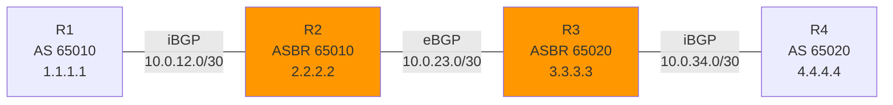

# eNSP BGP 多 AS 拓扑

> **跟 lab/clab/bgp-multi-as 完全同构**，方便对照练习。
> **真实度**：⭐⭐⭐⭐ 真 Huawei VRP 系统。

## 拓扑图

```
                AS 65010                                       AS 65020
   +-------+    iBGP    +-------+    eBGP    +-------+   iBGP    +-------+
   |  R1   |-----------|  R2   |------------|  R3   |----------|  R4   |
   | AR2240| 10.0.12/30 | AR2240| 10.0.23/30 | AR2240| 10.0.34/30 |AR2240 |
   +-------+  (loopback)+-------+            +-------+  (loopback)+------+
   (通告 10.1.0.0/16)   (ASBR 65010)        (ASBR 65020)         (通告 10.4.0.0/16)
```

| 设备 | 型号 | 关键 IP | 角色 |
|------|------|---------|------|
| R1 | AR2240 | GE0/0/0: 10.0.12.1/30<br>LoopBack0: 1.1.1.1/32 | AS 65010 内部 |
| R2 | AR2240 | GE0/0/0: 10.0.12.2/30<br>GE0/0/1: 10.0.23.2/30<br>LoopBack0: 2.2.2.2/32 | AS 65010 ASBR |
| R3 | AR2240 | GE0/0/0: 10.0.23.3/30<br>GE0/0/1: 10.0.34.3/30<br>LoopBack0: 3.3.3.3/32 | AS 65020 ASBR |
| R4 | AR2240 | GE0/0/0: 10.0.34.4/30<br>LoopBack0: 4.4.4.4/32 | AS 65020 内部 |

## 搭建步骤

1. 打开 eNSP
2. 拖 4 台 AR2240
3. 连 3 根线：R1-R2, R2-R3, R3-R4
4. 启动所有设备
5. 依次配置 R1 / R2 / R3 / R4（粘对应 cfg 文件）
6. 等待 BGP 收敛（30-60 秒）
7. 验证

## 拓扑 mermaid


