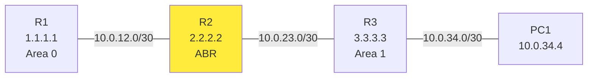

# eNSP 拓扑说明

> ⚠️ **重要**：eNSP 是 GUI 工具，**拓扑文件是二进制的，没法在 git 里 track**。
> 你需要在 eNSP 里**按下面的描述手动搭建**。配置可以**复制粘贴**。

---

## 拓扑图

```
   [Area 0]                    [Area 1]
[R1 AR2240] --10.0.12.0/30-- [R2 AR2240] --10.0.23.0/30-- [R3 AR2240] --10.0.34.0/30-- [PC1]
              GE0/0/0          (ABR)        GE0/0/1          GE0/0/1
```

| 设备 | 型号 | 接口 / IP | 角色 |
|------|------|----------|------|
| R1 | AR2240 | GE0/0/0: 10.0.12.1/30<br>LoopBack0: 1.1.1.1/32 | Area 0 |
| R2 | AR2240 | GE0/0/0: 10.0.12.2/30<br>GE0/0/1: 10.0.23.2/30<br>LoopBack0: 2.2.2.2/32 | **ABR**（Area 0 + Area 1）|
| R3 | AR2240 | GE0/0/0: 10.0.23.3/30<br>GE0/0/1: 10.0.34.3/30<br>LoopBack0: 3.3.3.3/32 | Area 1 |
| PC1 | - | 10.0.34.4/24, GW: 10.0.34.3 | 测试主机 |

## 在 eNSP 里搭建步骤

1. **打开 eNSP**，新建拓扑（File → New Topology）

2. **拖设备**（左侧设备栏）：
   - 路由器 × 3：选 **AR2240**（或 AR1220 / AR201，都行）
   - 终端 × 1：选 **PC**

3. **连线**：
   - R1.GE0/0/0 ⇄ R2.GE0/0/0（**Copper 直连**）
   - R2.GE0/0/1 ⇄ R3.GE0/0/0
   - R3.GE0/0/1 ⇄ PC1.Eth0/0/1

4. **启动所有设备**（右键 → Start，或者工具栏 ▶️）

5. **配置每台设备**（双击设备打开 CLI 窗口）：

```bash
# 顺序：R1 → R2 → R3 → PC1
# 在每台设备的 CLI 窗口里，粘对应的 cfg 文件内容
```

   - R1 → `configs/R1.cfg`
   - R2 → `configs/R2.cfg`
   - R3 → `configs/R3.cfg`
   - PC1 → 用 `ipconfig` 配（图形化）

6. **等待 OSPF 收敛**（约 10-20 秒）

7. **验证**：参考 `verify-commands.md`

## 拓扑图（mermaid 版）

如果你想先看清拓扑关系：



R2 是 ABR，用黄色高亮。
