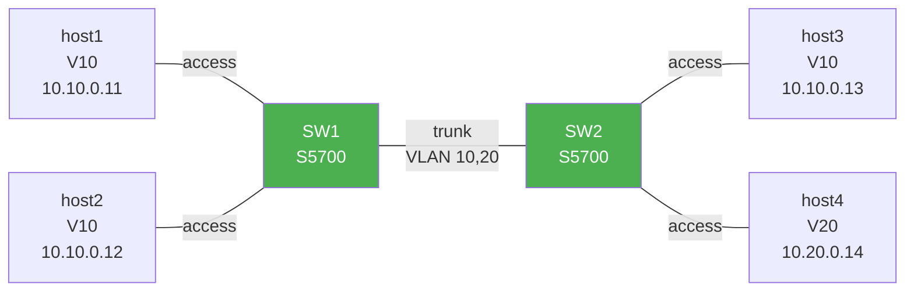

# eNSP VLAN + Trunk 拓扑

> 跟 `lab/clab/vlan-trunk` 完全同构（用 Huawei S5700 真交换机镜像）。

## 拓扑图

```
   VLAN 10                                  VLAN 10
  +--------+  GE0/0/1 +--------+  GE0/0/24 +--------+  GE0/0/1 +--------+
  | host1  |-----------|        |-----------|        |-----------| host3  |
  +--------+           |  SW1   |   trunk   |  SW2   |           +--------+
                       | S5700  |  VLAN     | S5700  |
  +--------+  GE0/0/2 |        |  10, 20   |        |  GE0/0/2 +--------+
  | host2  |-----------|        |-----------|        |-----------| host4  |
  +--------+           +--------+           +--------+           +--------+
   VLAN 10                                  VLAN 20
```

| 设备 | 型号 | 端口 / IP | 角色 |
|------|------|----------|------|
| SW1 | S5700 | GE0/0/1: host1<br>GE0/0/2: host2<br>GE0/0/24: trunk → SW2 | 接入 + 上行 |
| SW2 | S5700 | GE0/0/1: host3<br>GE0/0/2: host4<br>GE0/0/24: trunk → SW1 | 接入 + 上行 |
| host1 | PC | 10.10.0.11/24 | VLAN 10 |
| host2 | PC | 10.10.0.12/24 | VLAN 10 |
| host3 | PC | 10.10.0.13/24 | VLAN 10 (跨 trunk) |
| host4 | PC | 10.20.0.14/24 | VLAN 20 |

## 搭建步骤

1. 打开 eNSP
2. 拖 2 台 S5700 + 4 台 PC
3. 连 5 根线
4. 启动所有设备
5. 配 SW1 / SW2（粘 `configs/SW1.cfg` / `SW2.cfg`）
6. 配 4 台 host IP（在 eNSP 图形界面）
7. 等待 trunk 起来（10-20 秒）
8. 验证

## 拓扑 mermaid


